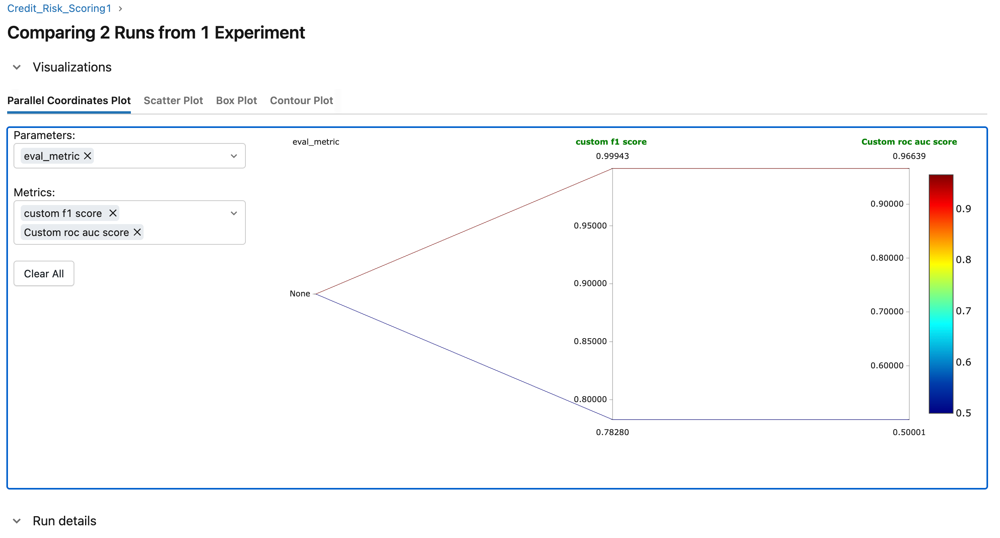

---

```markdown
# 🚀 Dynamic Credit Risk & Fraud Detection MLOps System

An end-to-end, production-grade MLOps pipeline built for tabular classification. This project demonstrates how to solve real-world machine learning engineering challenges—focusing on **Data Version Control (DVC)**, **Experiment Tracking & Lineage (MLflow)**, **Model Degradation/Drift Detection**, and **Low-Latency Serving (FastAPI & Docker)**.

---

## 📸 Project Screenshots

*(Tip: Place your screenshots inside an `assets/` folder in your repository and update the paths below!)*

### 1. MLflow Experiment Tracking & Data Drift Comparison
*Comparing baseline model metrics against drifted production data.*


### 2. Live FastAPI Swagger Docs & Inference Endpoint
*Low-latency real-time scoring via FastAPI.*


---

## 🛠️ Tech Stack & Tools
* **Language:** Python 3.9+
* **Core Modeling:** XGBoost, Scikit-Learn, Pandas, NumPy
* **Data Versioning:** DVC (Data Version Control) & Git
* **Experiment Tracking & Registry:** MLflow
* **API Framework:** FastAPI & Uvicorn
* **Containerization & Deployment:** Docker & Hugging Face Spaces

---

## 📂 Project Directory Structure

```text
credit-scoring-mlops/
├── data/
│   ├── raw/
│   │   ├── credit_data.csv          # Active dataset version tracked by DVC
│   │   └── credit_data.csv.dvc      # DVC pointer file
│   └── processed/                   # Processed data artifacts
├── model/
│   └── model.ubj                    # Production-ready serialized XGBoost binary
├── src/
│   ├── __init__.py
│   ├── train.py                     # Training script with MLflow logging & Git hash tagging
│   └── app.py                       # FastAPI application for model serving
├── assets/                          # Screenshots and media for README
├── Dockerfile                       # Container configuration
├── requirements.txt                 # Project dependencies
└── README.md

```

---

## ⚙️ Engineering Highlights & Architecture

1. **Data Version Control (DVC):** Heavy CSV datasets are decoupled from Git and version-controlled via DVC. This allows full reproducibility of data variants (baseline vs. simulated production drift).
2. **Lineage Tracking:** Every MLflow experiment run captures parameter configurations, evaluation metrics (F1-score, ROC-AUC), and injects the active **Git commit hash** (`data_git_commit`) as a run tag to tie code and data versions together.
3. **Drift Simulation:** The pipeline explicitly simulates model performance degradation under feature drift and label shift, visualized directly through MLflow.
4. **Production Serving:** Models are packaged and served via a high-performance **FastAPI** REST microservice wrapped in a **Docker** container.

---

## 🚀 Getting Started Locally

### 1. Clone the Repository

```bash
git clone [https://github.com/abhishek-codeit/ml-project.git]https://github.com/abhishek-codeit/ml-project.git)
cd credit-scoring-mlops

```

### 2. Set Up Virtual Environment & Dependencies

```bash
python -m venv .venv
source .venv/bin/activate   # On Windows use: .venv\Scripts\activate
pip install -r requirements.txt

```

### 3. Pull Data via DVC

```bash
dvc pull

```

### 4. Run the API Locally

```bash
uvicorn src.app:app --reload

```

The interactive documentation will be live at: `http://127.0.0.1:5001/docs`

---

## 🔌 Testing the Inference API

You can test the prediction endpoint by sending a POST request with transaction features:

```bash
curl -X 'POST' \
  '[http://127.0.0.1:5001/predict](http://127.0.0.1:5001/predict)' \
  -H 'accept: application/json' \
  -H 'Content-Type: application/json' \
  -d '{
    "Time": 406.0,
    "V1": -2.3122, "V2": 1.9519, "V3": -1.6098, "V4": 3.9979,
    "V5": -0.5221, "V6": -1.4265, "V7": -2.5373, "V8": 1.3916,
    "V9": -2.7700, "V10": -2.7722, "V11": 3.2020, "V12": -2.8999,
    "V13": -0.5952, "V14": -4.2892, "V15": 0.3897, "V16": -1.1407,
    "V17": -2.8300, "V18": -0.0168, "V19": 0.4169, "V20": 0.1269,
    "V21": 0.5172, "V22": -0.0350, "V23": -0.4652, "V24": 0.3201,
    "V25": 0.0445, "V26": 0.1778, "V27": 0.2611, "V28": -0.1432,
    "Amount": 0.00
}'

```

---

## 👤 Author

**Abhishek**

* [LinkedIn](https://www.linkedin.com/in/abhisheks-codeit)
* [GitHub](https://www.google.com/search?q=https://github.com/abhishek-codeit)

```
